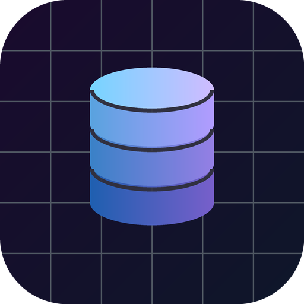

# ⚡ SQLMind

<div align="center">



### **AI-Powered Natural Language SQL Engine & Interactive Learning Studio for Android**

[](https://kotlinlang.org)
[](https://developer.android.com)
[](https://developer.android.com/jetpack/compose)
[](https://ai.google.dev)
[](https://developer.android.com/training/data-storage/room)

</div>

---

## 📖 Overview

**SQLMind** is an Android application that bridges the gap between human language and database architecture. Powered by **Google Gemini 2.0**, SQLMind translates natural conversational English into optimized SQL queries and reverses complex queries into clear, plain-English explanations.

In addition to intelligent AI translation, SQLMind features a **24-Session Interactive SQL Curriculum** divided into Basic, Moderate, and Advanced mastery tiers, complete with live query runners and offline persistence.

---

## ✨ Key Features

### 🧠 1. Dual AI Translation Engine
- **Text-to-SQL (`NL -> SQL`)**: Convert questions like *"Find the top 5 highest-paid employees in engineering hired after 2022"* into clean, index-friendly, dialect-specific SQL.
- **SQL-to-Explanation (`SQL -> NL`)**: Break down nested subqueries, CTEs, window functions, and joins into digestible step-by-step logic.
- **Query Optimization Tips**: Receive contextual performance suggestions, index hints, and dialect adaptations (PostgreSQL, MySQL, SQLite, T-SQL).

### 🎓 2. Interactive 24-Session Learning Curriculum
A structured, query-driven SQL curriculum spanning 24 interactive modules:
- 🟢 **Basic Tier (B1 - B8)**: Database Foundations, `SELECT`, Filtering with `WHERE`, Sorting (`ORDER BY`), Aggregations (`COUNT`, `SUM`, `AVG`), Grouping (`GROUP BY`), and Basic `JOIN` concepts.
- 🟡 **Moderate Tier (M1 - M8)**: Multi-table `INNER`/`LEFT`/`RIGHT` Joins, `HAVING` filters, Subqueries, `UNION` vs `UNION ALL`, String functions, Date/Time manipulation, and `CASE WHEN` logic.
- 🟣 **Advanced Tier (A1 - A8)**: Window Functions (`ROW_NUMBER`, `DENSE_RANK`, `PARTITION BY`), Common Table Expressions (CTEs & Recursive CTEs), Indexing & Query Plans, Transactions (`ACID`), Database Normalization (1NF–3NF), and Stored Procedures.
- **One-Tap "Try Query"**: Instantly send any lesson's example query into the AI execution studio.

### 💾 3. Offline-First Architecture & History
- Built on **Android Room Database** to locally archive translated queries and curriculum progress.
- Access previously generated SQL snippets, custom notes, and favorite templates even when disconnected from the internet.

### 🎨 4. Modern Cyberpunk Glassmorphic UI
- Designed entirely in **Jetpack Compose** with Material 3 components.
- Dark-mode-first aesthetic with deep space backgrounds, glowing neon cyan (`#38BDF8`) & purple (`#A855F7`) accents, and responsive layout animations.

---

## 🛠️ Architecture & Tech Stack

| Layer | Technology |
|---|---|
| **Language** | Kotlin 2.0 |
| **UI Toolkit** | Jetpack Compose (100% declarative UI) |
| **Design System** | Material 3 with custom Cyberpunk / Dark Glassmorphism themes |
| **AI Backend** | Google Generative AI SDK (Gemini 2.0 Flash) |
| **Local Database** | Android Jetpack Room (SQLite abstraction) |
| **Concurrency** | Kotlin Coroutines & Asynchronous Flow |
| **Dependency Management** | Gradle Version Catalogs (`libs.versions.toml`) |
| **Build System** | Gradle 8.11.1 / Android Gradle Plugin 8.9.0 |

---

## 🚀 Getting Started

### Prerequisites
- [Android Studio Ladybug (or newer)](https://developer.android.com/studio)
- Android SDK 35 (Minimum SDK: 24 / Android 7.0+)
- JDK 17 or JDK 21 (Android Studio bundled JBR recommended)
- A [Google Gemini API Key](https://aistudio.google.com/app/apikey)

### Installation & Setup

1. **Clone the Repository**
   ```bash
   git clone https://github.com/shakilshaik11/SQLMind.git
   cd SQLMind
   ```

2. **Configure your API Key**
   Create a `.env` file in the root project directory:
   ```env
   GEMINI_API_KEY=your_actual_gemini_api_key_here
   ```
   *(Note: The `.env` file is included in `.gitignore` to prevent leaking credentials).*

3. **Build the Project**
   Open the project folder in Android Studio and let Gradle sync. Or build directly from terminal:
   ```bash
   # Windows PowerShell
   .\gradlew assembleDebug

   # macOS / Linux
   ./gradlew assembleDebug
   ```

4. **Run on Device / Emulator**
   Press **Run** (`Shift + F10`) in Android Studio or install the generated APK:
   ```bash
   adb install app/build/outputs/apk/debug/app-debug.apk
   ```

---

## 📁 Project Structure

```
sql-translator/
├── app/
│   ├── src/main/
│   │   ├── java/com/example/
│   │   │   ├── data/                 # Room entities, DAOs, LearningData (24 lessons)
│   │   │   ├── network/              # Gemini AI client & prompt engineering
│   │   │   ├── ui/
│   │   │   │   ├── screens/          # TranslateScreen, LearnScreen, HistoryScreen
│   │   │   │   └── theme/            # Color palettes, Typography, Glassmorphic Theme
│   │   │   └── MainActivity.kt       # Navigation graph & top-level scaffolding
│   │   └── res/                      # Adaptive vector icons, mipmaps, string resources
│   └── build.gradle.kts              # Module-level build configuration
├── gradle/
│   └── libs.versions.toml            # Centralized version catalog
├── .env.example                      # Template for environment variables
├── .gitignore                        # Git ignore rules (.env, build caches, APKs)
└── README.md                         # Project documentation
```

---

## 🛡️ Security & Privacy
- **Zero API Key Leakage**: API tokens are sourced exclusively from environment files (`.env`) ignored by version control.
- **Sandboxed Execution**: Offline database caches operate in private app-specific storage.

---

## 👤 Author

Developed by **Shakil Shaik**
- GitHub: [@shakilshaik11](https://github.com/shakilshaik11)
- Email: [shakilshaik362@gmail.com](mailto:shakilshaik362@gmail.com)

---

## 📄 License
This project is open-source and available under the [MIT License](LICENSE).
